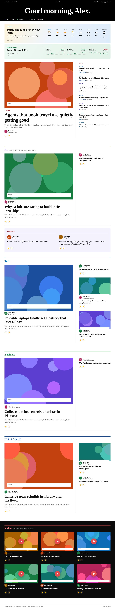

# sharectl-edition

**Talk to your AI. It asks what you want to read, creates your personal newspaper, and changes it as your interests change.**

sharectl-edition is a skill for your own AI agent. Start with a conversation: your agent asks about your interests, preferred sources, and what you would rather skip. It saves your answers, builds your first edition, and helps you choose where to publish it. Come back to the same agent whenever you want to change your paper.

Part of [sharectl.com](https://sharectl.com). Your paper is a static web page with headlines, short summaries, images, and links to the original publishers. Writers come before outlets. The paper is in your language, whatever it is. The Python builder uses only the standard library and runs in your agent's environment.

## Start with a conversation

Give an AI agent that can run Python and edit files this request:

> Install the sharectl edition skill from https://github.com/bowetter1/sharectl-edition and set up my morning paper.

Your agent follows [`SKILL.md`](SKILL.md) to:

1. **Ask what you want.** Your name and language, topics and news sources, optional YouTube channels, what to include or avoid, time zone, and optional weather location. If you want a daily edition, it also asks when it should be ready.
2. **Create your first paper.** It turns your answers into saved preferences, fetches your sources, and builds an edition for you to read.
3. **Help you publish and schedule it.** You choose where it lives. Public publishing needs your approval and hosting access; daily delivery depends on your agent's scheduling support.
4. **Keep editing through conversation.** Tell the agent what to change. It updates the saved rules for future builds and can rebuild today's edition when you ask.

### What that conversation can look like

*Illustrative example:*

> **You:** Make me a morning paper.
>
> **Your AI:** What should I call you? What topics and sources do you enjoy, and what should I leave out? Would you like weather or YouTube videos?
>
> **You:** Call me Alex. Mostly AI and technology, especially Simon Willison and Ars Technica. Very little politics.
>
> **Your AI:** I'll save those preferences and build your first edition.

Then, after reading:

> **You:** More AI, less crypto, and no more than two stories from The Verge. Rebuild today's paper.
>
> **Your AI:** I'll update your preferences and rebuild it with those rules.

You can also say "add this YouTube channel", "remove the weather", or "show my preferences". Your agent handles the configuration files; you describe the newspaper you want. Changes are stored locally and used in future builds.

## See an example

👉 **[Live demo: utgava.sharectl.com](https://utgava.sharectl.com/)**



## Quickstart: by hand

```bash
git clone https://github.com/bowetter1/sharectl-edition.git && cd sharectl-edition
cp config.example.json config.json        # edit name, sources, rules
python3 -m sharectl_edition build --config config.json --out site/
open site/index.html
```

Python 3.10+, standard library only.

## What's in a paper

- **Morning box**: weather (Open-Meteo, no key) and an optional markets box.
- **Top story** with the latest headlines beside it.
- **Sections** you define (AI, Tech, Business, U.S. & World...): one big story, a column beside it, two-column stories, briefs.
- **Voices from X**: posts from people you follow, if your agent has X access.
- **Video**: new uploads from your YouTube channels, on a black page with round red play buttons.
- **Why?**: at the end, which sources were in today's paper and what the rules left out, then a closing line. The paper ends.
- **Your language**: every word the page itself says comes from one table of strings. English and Swedish are built in; for any other language your agent translates the table into `config.json`.
- **Plain-language feedback**: Tell your agent what you want more or less of ("more AI", "less politics", "hide Tesla"), and it adjusts the paper.

## How selection works

`sharectl_edition/select.py`, in order: hidden sources and muted keywords out; each source's items ranked by your
feedback and boost keywords; near-duplicate headlines across sources removed; politics capped (configurable keyword
list); per-source caps; round-robin across sources so no single outlet takes over. Every decision is in `site/report.json`.

## Commands

```
python -m sharectl_edition build    --config config.json --out site/
python -m sharectl_edition publish  --config config.json          # github (default) | cloudflare | sharectl | static
python -m sharectl_edition feedback show --config config.json
python -m sharectl_edition feedback boost SOURCE 1.0 --config config.json
python -m sharectl_edition feedback mute KEYWORD -0.5 --config config.json
python -m sharectl_edition feedback hide SOURCE --config config.json
python -m sharectl_edition strings --lang en                      # the UI strings as JSON, to translate into your language
```

## Publishing

**GitHub Pages (recommended):** Set `"target": "github"` in `config.json` publish section. The agent pushes to a `gh-pages` branch in your repo. Enable Pages in your repo settings (Settings > Pages > Source: gh-pages branch). Your edition will be live at `https://USERNAME.github.io/REPO-NAME/`.

**Cloudflare Pages:** Set `"target": "cloudflare"` and provide `CLOUDFLARE_API_TOKEN` and `CLOUDFLARE_ACCOUNT_ID` environment variables.

**Static:** Set `"target": "static"` to build locally and serve from any static host.

## Layout

```
SKILL.md                  instructions for the agent
config.example.json       US defaults: AP, The Verge, TechCrunch, Ars Technica, NYT Tech, Hacker News, Simon Willison, Stratechery, AI YouTube
sharectl_edition/
  fetch/                  news.py (RSS/Atom + Open Graph + bylines), youtube.py, x.py, weather.py, markets.py
  select.py               the editorial rules
  feedback.py             saved source, author and keyword preferences (local JSON)
  render/                 template.py, edition.css, labels.py (all UI strings, en and sv built in)
  publish/                static.py, github.py, cloudflare.py, sharectl.py
tests/                    python3 -m unittest discover -s tests
examples/                 a sample edition built from made-up data (examples/items.json)
```

## Being a good citizen

The paper shows a headline, a short summary, the lead image and the byline, and links to the publisher for the rest.
Full articles are never copied. Article pages are only read when robots.txt allows it, and requests identify as
`sharectl-edition`. Each paper is for one reader and is marked `noindex`.

## License

MIT. See [LICENSE](LICENSE).
